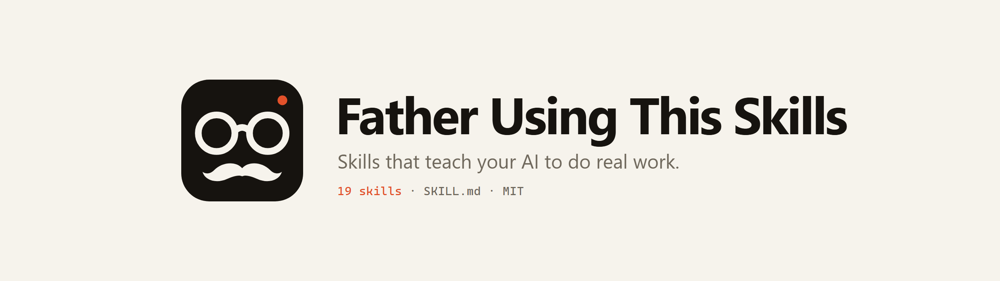

<p align="center">
  <picture>
    <source media="(prefers-color-scheme: dark)" srcset="docs/banner-dark.png">
    
  </picture>
</p>

<p align="center">
  <a href="LICENSE"></a>
  
  <a href="https://agentskills.io"></a>
  <a href="CONTRIBUTING.md"></a>
</p>

> A collection of ready-to-use skills that teach Claude — and any AI agent that reads `SKILL.md` — to do real work: documents, spreadsheets, slides, PDFs, video, research, browsing and more.

**Skills** are folders of instructions, scripts and reference files that an AI agent loads only when your request needs them. Install one, then ask for the job in plain words. You never have to name the skill.

---

## 📚 Contents

- [How skills work](#-how-skills-work)
- [Getting started](#-getting-started)
- [The skills](#-the-skills)
- [Use with other AI tools](#-use-with-other-ai-tools)
- [Skills vs other approaches](#-skills-vs-other-approaches)
- [Create your own skill](#-create-your-own-skill)
- [Requirements](#-requirements)
- [Security](#-security)
- [Troubleshooting](#-troubleshooting)
- [FAQ](#-faq)
- [Resources](#-resources)
- [Contributing](#-contributing)
- [License](#-license)

---

## 🧠 How skills work

A skill is a folder with a `SKILL.md` at its top:

```
pdf-tools/
├── SKILL.md        what the skill is for, and the method to follow
├── scripts/        tools the agent runs instead of improvising
├── references/     deeper guides, opened only when needed
└── LICENSE.txt
```

The agent loads it in three steps, so installing many skills costs almost nothing:

1. **Always:** it knows only each skill's name and one-line description.
2. **When your request matches:** it reads that skill's `SKILL.md`.
3. **Only if needed:** it opens a reference file or runs a script.

---

## 🚀 Getting started

### Claude apps (web, desktop, mobile)

1. Open **Settings → Capabilities → Skills**.
2. Click **Upload skill** and choose a `.skill` file from [`user/`](user), for example `user/pdf-tools.skill`.
3. Ask for the job: *"Fill in this PDF form with my details."*

### Claude Code

```bash
git clone https://github.com/SahilRakhaiya05/Father-Using-This-Skills.git
cp -r SahilRakhaiya05/Father-Using-This-Skills/pdf-tools ~/.claude/skills/        # one skill
cp -r SahilRakhaiya05/Father-Using-This-Skills/*/ ~/.claude/skills/               # every skill
```

On Windows PowerShell:

```powershell
Copy-Item -Recurse .\user\pdf-tools $env:USERPROFILE\.claude\skills\
```

Use `~/.claude/skills/` for every project, or `.claude/skills/` inside one project to share the skill with your team.

### Claude API

Upload a skill folder once, then attach it to any request. Skills run inside the code execution tool.

```python
import anthropic
from anthropic.lib import files_from_dir

client = anthropic.Anthropic()

skill = client.skills.create(files=files_from_dir("user/pdf-tools"))

response = client.messages.create(
    model="claude-opus-5-5",
    max_tokens=4096,
    container={"skills": [{"type": "custom", "skill_id": skill.id, "version": "latest"}]},
    tools=[{"type": "code_execution_20250825", "name": "code_execution"}],
    messages=[{"role": "user", "content": "Merge these two PDFs and add page numbers."}],
)
```

See Anthropic's [Skills guide](https://platform.claude.com/docs/en/build-with-claude/skills-guide) for versions, limits and other languages.

---

## 🧰 The skills

Every skill lives in [`user/`](user) with a ready-to-upload `.skill` file beside it.

### Documents

- **[word-docs](user/word-docs)** — Create and edit Word files with real tracked changes, threaded comments, and a check that nothing changed untracked.
- **[excel-sheets](user/excel-sheets)** — Workbooks with live formulas, a formula checker that fixes common mistakes, and recalculation.
- **[powerpoint-decks](user/powerpoint-decks)** — Themed decks with 12 layouts, one-command restyling, and an automatic layout check.
- **[pdf-tools](user/pdf-tools)** — Create, merge, split, rotate, watermark, encrypt and OCR PDFs; fills both fillable and flat forms.
- **[pdf-reader](user/pdf-reader)** — Pull text, tables and page images out of a PDF, with scan detection and a reading plan.
- **[shareable-docs](user/shareable-docs)** — Write once in Markdown and get a web page, a Word file and a PDF.
- **[google-files](user/google-files)** — Edit Google Docs, Sheets and Slides through the API without overwriting someone else's changes.

### Files

- **[file-reader](user/file-reader)** — A safe first look at any file type, including archives and very large files.

### Video

- **[video-making](user/video-making)** — Slideshows, trims, joins, captions, music and social sizes from your own photos and footage.
- **[motion-graphics](user/motion-graphics)** — Animated videos made from code — titles, explainers, charts and overlays — in a choice of visual styles.

### Research and writing

- **[research-report](user/research-report)** — Sourced reports with a clear bottom line and the counter-arguments.
- **[doc-coauthor](user/doc-coauthor)** — Co-write long documents section by section, ending with a cold-reader test.
- **[writing-style](user/writing-style)** — Learn your writing voice, with your consent, and write in it.
- **[morning-brief](user/morning-brief)** — A one-page daily brief with a timeline of your day.

### Browser and desktop

- **[browser-automation](user/browser-automation)** — Careful browsing in your own browser or a sandbox, with screenshots at any size.
- **[page-preview](user/page-preview)** — Check a web page at phone, tablet and desktop size, in light and dark mode.
- **[desktop-control](user/desktop-control)** — Use desktop apps step by step, stopping to confirm anything risky.

### Setup and knowledge

- **[memory-import](user/memory-import)** — Bring memories over from another assistant, adding without overwriting.
- **[product-facts](user/product-facts)** — Answer questions about Claude by checking the official docs, not memory.

<details>
<summary><b>Bundled open-source skills (25)</b></summary>

The repository also carries open-source skills published by Anthropic and other authors, unchanged and under their own Apache 2.0 licence:

- **`examples/`** — algorithmic-art, benepass-reimbursement, brand-guidelines, call-to-book, cancel-unsubscribe, canvas-design, event-planning, file-expenses, file-form, financial-calculator, grocery-shopping, hire-help, internal-comms, learn, mcp-builder, meal-delivery, paint, prescription-refill, return-refund, skill-creator, slack-gif-creator, theme-factory, web-artifacts-builder
- **`public/`** — frontend-design
- **`plugin-files/`** — cowork-plugin-management
</details>

---

## 🔌 Use with other AI tools

These skills use the open [Agent Skills](https://agentskills.io) format, which many coding agents read. Copy a skill folder into the place your tool looks:

| Tool | All your projects | One project |
|---|---|---|
| Claude Code | `~/.claude/skills/` | `.claude/skills/` |
| OpenAI Codex | `~/.agents/skills/` | `.agents/skills/` |
| Cursor | `~/.cursor/skills/` | `.cursor/skills/` |
| GitHub Copilot (VS Code, CLI) | `~/.copilot/skills/` | `.github/skills/` |
| Gemini CLI | `~/.gemini/skills/` | `.gemini/skills/` |
| OpenCode | `~/.config/opencode/skills/` | `.opencode/skills/` |

The shared `.agents/skills/` folder is read by Codex, Cursor, Gemini CLI and OpenCode, so one copy can serve all four. Paths were checked against each tool's docs in November 2026; tools change, so check yours if a skill does not appear.

**With the `skills` installer.** The community [`skills`](https://github.com/vercel-labs/skills) command installs a skill into whichever agents you use:

```bash
npx skills add https://github.com/SahilRakhaiya05/Father-Using-This-Skills/tree/main/user/pdf-tools
npx skills add https://github.com/SahilRakhaiya05/Father-Using-This-Skills/tree/main/user/pdf-tools -a cursor -g
```

`-a` picks the agent and `-g` installs it for all your projects.

**ChatGPT, Gemini or any chat assistant.** A skill is plain text, so it still works as instructions. Paste `SKILL.md` into a Project, custom GPT, Gem or system prompt, and upload the `references/` files as knowledge. Skills with `scripts/` also need somewhere to run code.

> [!NOTE]
> These skills were built and tried with Claude. Other tools read the same format but have not been tested here.

---

## ⚖️ Skills vs other approaches

| | A prompt | A skill | An MCP server |
|---|---|---|---|
| **What it is** | Text you type each time | A folder of method and tools, loaded when needed | A running service that gives the agent new actions |
| **Best for** | One-off requests | Doing a kind of job the right way every time | Reaching live systems: mail, databases, apps |
| **Carries code** | No | Yes — scripts it runs | Yes — tools over a connection |
| **Cost when idle** | — | One line of description | Its list of tools |

They work together: an MCP server lets the agent *reach* your Google Drive; the google-files skill teaches it to *edit a Doc without breaking it*.

---

## 🛠️ Create your own skill

1. Make a folder named after the job, in lowercase with hyphens: `my-skill/`.
2. Add a `SKILL.md` that starts with:

   ```yaml
   ---
   name: my-skill
   description: What it does and when to use it, in one or two sentences.
   ---
   ```
3. Below that, write the method: steps, rules, and the mistakes to avoid.
4. Put repeatable work in `scripts/` and long detail in `references/`, and say in `SKILL.md` when to use each.

The bundled [skill-creator](examples/skill-creator) walks you through it and packages the result. [CONTRIBUTING.md](CONTRIBUTING.md) explains what makes a good skill.

---

## 📦 Requirements

Instruction-only skills need nothing. Skills with scripts need **Python 3.8 or newer**, plus:

| Skill | Install |
|---|---|
| word-docs, excel-sheets, powerpoint-decks | `pip install python-docx openpyxl python-pptx lxml` · LibreOffice for PDF export and recalculation |
| pdf-tools, pdf-reader | `pip install pypdf pdfplumber reportlab` · poppler and tesseract for page images and OCR |
| shareable-docs | pandoc |
| video-making | ffmpeg · `pip install pillow` |
| motion-graphics | ffmpeg · `pip install playwright pillow` · `python -m playwright install chromium` |
| browser-automation, page-preview | `pip install playwright` · `python -m playwright install chromium` |

Each skill's `SKILL.md` lists exactly what it needs.

---

## 🔒 Security

> [!WARNING]
> A skill can include scripts that run on your computer with your permissions. Read a skill before you install it — these ones and anyone else's.

- **No secrets inside.** No keys, passwords or personal paths are stored in any skill.
- **Confirm before risky steps.** Skills that act for you — browser, desktop and memory import — tell the agent to stop and ask before installing, sending, paying or deleting.
- **Content is data.** Skills that read outside material tell the agent to treat it as information, never as instructions.
- **Keep your tool's own permission prompts on.** No instruction can fully guarantee how an agent behaves.

---

## 🩺 Troubleshooting

**The skill does not appear.**
Check the folder is in the right place and has `SKILL.md` directly inside it, not in a subfolder. Then start a new session.

**The agent does not use the skill.**
Skills are chosen by their description. Ask for the job in ordinary words ("fill in this PDF form"), or name the skill outright.

**A script fails with "not found".**
A tool it needs is missing from your PATH. See [Requirements](#-requirements).

**Upload fails in the Claude apps.**
Upload the `.skill` file, not the folder, and check that skills are turned on under **Settings → Capabilities**.

---

## ❓ FAQ

**Do I have to install all of them?**
No. Each skill stands alone. Install only what you need.

**Can I use them for client or commercial work?**
Yes. The MIT License allows it. Keep the licence file with any copy you pass on.

**Can I change a skill?**
Yes. Edit `SKILL.md` or the scripts however you like. If you improve one, a pull request is welcome.

**Do they work on Windows, macOS and Linux?**
The scripts are Python and use cross-platform tools. The document skills were developed on Linux and expect LibreOffice, pandoc and similar tools on the PATH.

**Is this an official Anthropic project?**
No. It is an independent community project — see [License](#-license).

---

## 🔗 Resources

- [Agent Skills overview](https://platform.claude.com/docs/en/agents-and-tools/agent-skills/overview) — Anthropic's docs
- [Skills guide for the API](https://platform.claude.com/docs/en/build-with-claude/skills-guide) — upload and use skills in requests
- [Agent Skills open format](https://agentskills.io) — the shared `SKILL.md` standard
- [anthropics/skills](https://github.com/anthropics/skills) — Anthropic's official example skills
- [vercel-labs/skills](https://github.com/vercel-labs/skills) — install skills into many agents at once

---

## 🤝 Contributing

New skills, fixes and ideas are welcome. Read [CONTRIBUTING.md](CONTRIBUTING.md), then open a pull request. Release notes are in [CHANGELOG.md](CHANGELOG.md).

---

## 📄 License

The skills in `user/` (and their copies in `private/`, `organization/` and `plugins/`) are released under the [MIT License](LICENSE). Copyright (c) 2026 the skills collection authors.

The bundled skills in `examples/`, `public/` and `plugin-files/` keep their own authors' copyright and the Apache License 2.0. Several skills in `user/` were written as alternatives to Anthropic's built-in skills and follow their ideas; credits are in [NOTICE](NOTICE).

This is an independent community project. It is not affiliated with, sponsored by or endorsed by Anthropic. "Claude" is a trademark of Anthropic, used here only to say which product the skills work with.
